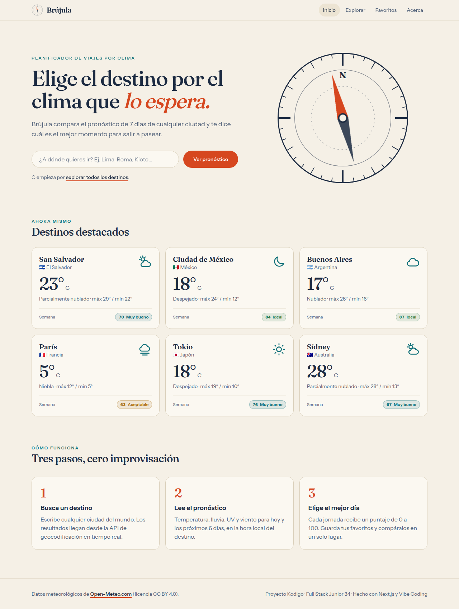
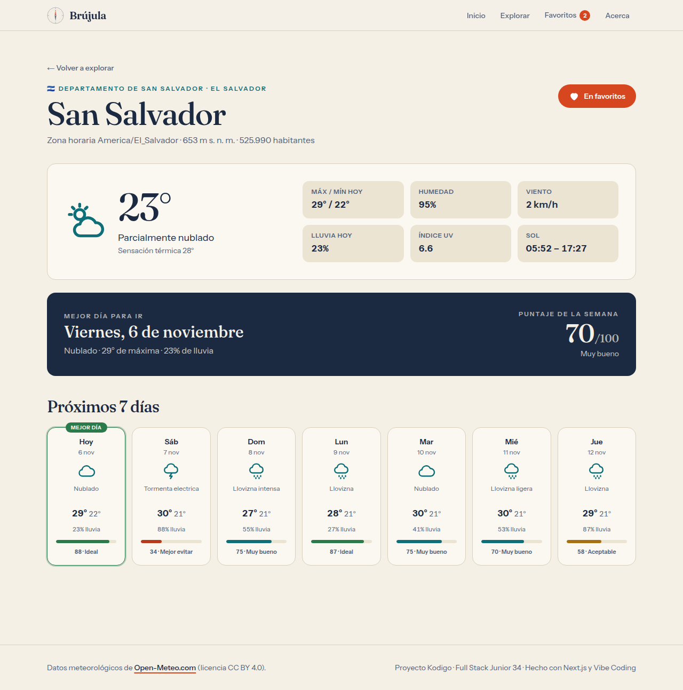
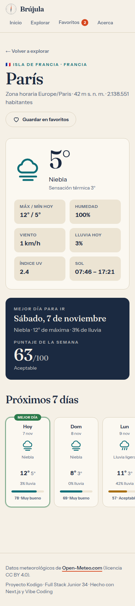
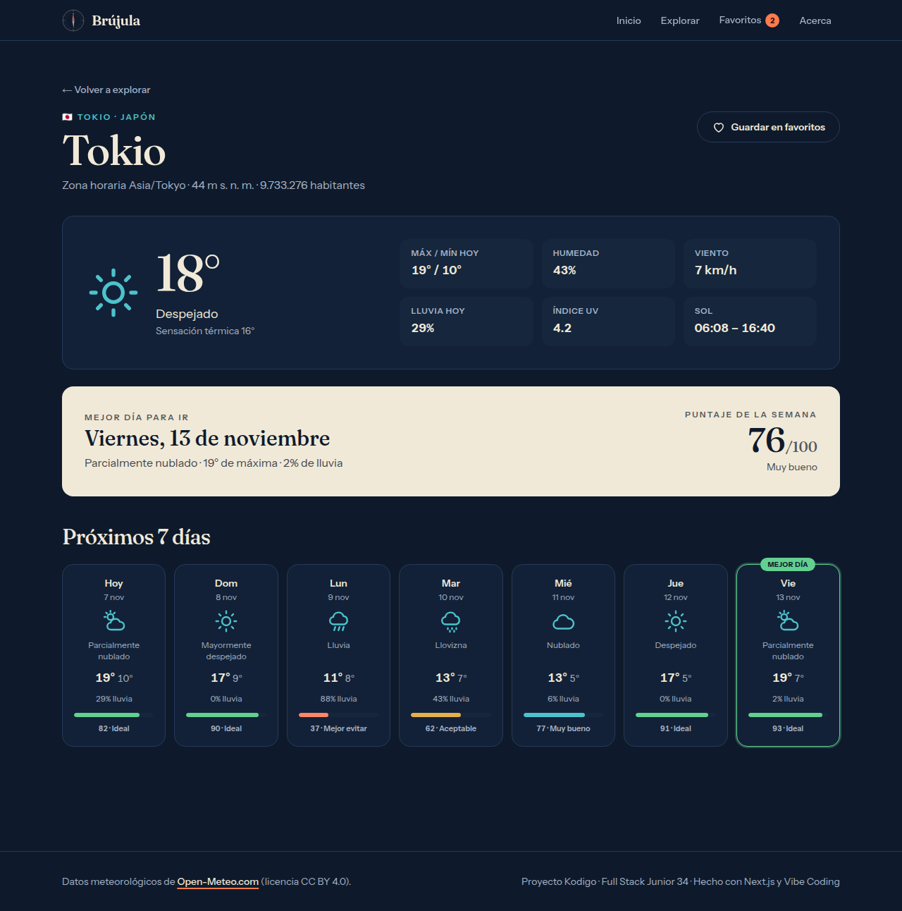
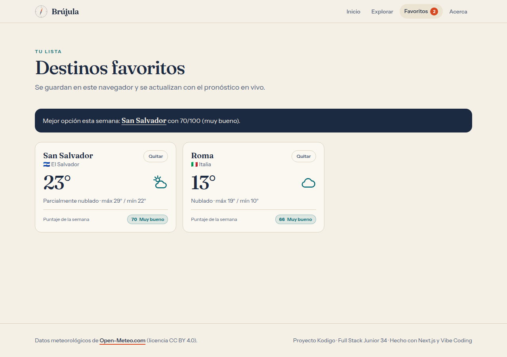
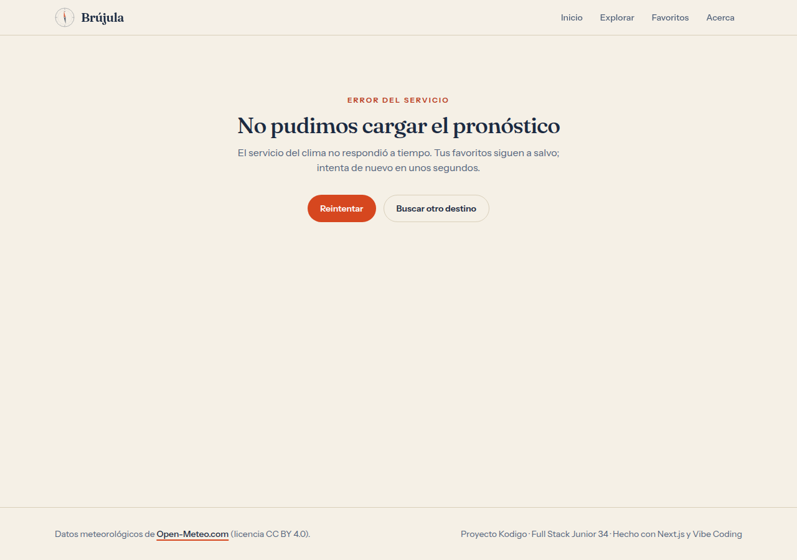

# Brújula · Elige tu destino por el clima

Aplicación web hecha con **Next.js 16 (App Router) + TypeScript + Tailwind CSS 4** para la actividad de la Semana 21 del bootcamp *Full Stack Junior 34* de Kodigo, construida con la metodología de **Vibe Coding** (una IA genera el código, la persona dirige, valida e itera).

Brújula compara el pronóstico de 7 días de cualquier ciudad del mundo y calcula un **puntaje de viaje de 0 a 100** por jornada para recomendar el mejor día para salir. Los destinos se pueden guardar en favoritos y compararse entre sí.

- **Aplicación en producción:** https://brujula-sage.vercel.app
- **Repositorio:** https://github.com/javacachava/kodigo-brujula-nextjs-vibe-coding
- **Proceso de Vibe Coding:** [VIBE_CODING.md](./VIBE_CODING.md)

## Cumplimiento de los requisitos de la actividad

| Requisito | Cómo se cumple |
| --- | --- |
| Next.js 16+ con App Router | Next.js 16.4 (`src/app`), Cache Components y Partial Prefetching activos |
| TypeScript | `strict` activado, tipos compartidos en `src/lib/types.ts` |
| Mínimo 4 rutas | `/`, `/explorar`, `/ciudad/[id]`, `/favoritos`, `/acerca` |
| API externa o interna con Route Handlers | `GET /api/ciudades` y `GET /api/clima` encapsulan la API de Open-Meteo |
| Server y Client Components combinados | Páginas y tarjetas del servidor; buscador, favoritos y navegación en el cliente |
| Estado con `useState` / `useEffect` | `CitySearch` (búsqueda con debounce) y `FavoritesBoard` (clima en vivo por favorito) |
| Diseño responsive | Revisado en 390 px (móvil) y 1280 px (escritorio), con tema claro y oscuro automático |
| Estados de carga | `loading.tsx` (raíz y `/ciudad/[id]`), `<Suspense>` con skeletons y spinners en cliente |
| Estados de error | `error.tsx` (raíz y `/ciudad/[id]`), `not-found.tsx`, y bloques de error con «Reintentar» en el cliente |
| Variables de entorno en `.env.local` | URLs de las APIs y URL del sitio; plantilla en `.env.example` |
| Despliegue público | Vercel |
| Historial de commits iterativo | Commits pequeños y descriptivos (`git log --oneline`) |

## Capturas

| Portada (escritorio) | Detalle de ciudad (escritorio) |
| --- | --- |
|  |  |

| Detalle (móvil) | Modo oscuro | Favoritos | Estado de error |
| --- | --- | --- | --- |
|  |  |  |  |

Estado de carga en móvil: [`docs/capturas/carga-movil.png`](./docs/capturas/carga-movil.png).

## Rutas

| Ruta | Tipo | Descripción |
| --- | --- | --- |
| `/` | Server | Portada con buscador y 6 destinos destacados (cada tarjeta en su propio `<Suspense>`) |
| `/explorar` | Server + Client | Buscador de ciudades con debounce; admite `?q=` |
| `/ciudad/[id]` | Server | Clima actual, mejor día de la semana y pronóstico de 7 días |
| `/favoritos` | Client | Destinos guardados en `localStorage` con su clima en vivo |
| `/acerca` | Server | Explicación del puntaje y de las tecnologías |
| `/api/ciudades?q=` | Route Handler | Busca ciudades (2–80 caracteres). `400` si el parámetro es inválido, `502` si falla el servicio |
| `/api/clima?lat=&lon=` | Route Handler | Pronóstico actual + 7 días. `400` si las coordenadas son inválidas, `502` si falla el servicio |

## Cómo se calcula el puntaje

`src/lib/travel-score.ts`: 40 % temperatura máxima (ideal entre 21 y 28 °C), 45 % probabilidad de lluvia y 15 % índice UV; las tormentas eléctricas restan 20 puntos. Rangos: **Ideal** (80+), **Muy bueno** (65–79), **Aceptable** (45–64) y **Mejor evitar** (0–44).

## Instalación y uso

Requisitos: Node.js 20.9 o superior (probado con Node 24) y npm.

```bash
git clone <url-del-repositorio>
cd brujula
npm install
cp .env.example .env.local   # ajusta los valores si lo necesitas
npm run dev                  # http://localhost:3000
```

Otros comandos:

```bash
npm run lint    # ESLint
npm run build   # compilación de producción
npm run start   # sirve la compilación de producción
```

### Variables de entorno

Se leen desde `.env.local` (en desarrollo) o desde el panel del proveedor (en producción). **Ninguna es obligatoria**: las APIs de Open-Meteo no requieren clave en el plan gratuito y existen valores por defecto en `src/lib/config.ts`.

| Variable | Descripción | Valor por defecto |
| --- | --- | --- |
| `GEOCODING_API_URL` | URL base de la API de geocodificación | `https://geocoding-api.open-meteo.com/v1` |
| `FORECAST_API_URL` | URL base de la API de pronóstico | `https://api.open-meteo.com/v1` |
| `OPEN_METEO_API_KEY` | Clave opcional (solo plan comercial) | vacía |
| `NEXT_PUBLIC_SITE_URL` | URL pública, usada en metadatos Open Graph | `http://localhost:3000` |

## Estructura

```
src/
├── app/
│   ├── api/ciudades/route.ts    # Route Handler de búsqueda
│   ├── api/clima/route.ts       # Route Handler de pronóstico
│   ├── ciudad/[id]/             # page, loading, error y not-found
│   ├── explorar/  favoritos/  acerca/
│   ├── error.tsx  loading.tsx  not-found.tsx  layout.tsx  page.tsx
│   └── globals.css              # tokens de diseño claro/oscuro
├── components/                  # UI (server y client)
└── lib/
    ├── open-meteo.ts            # cliente tipado con `use cache`
    ├── travel-score.ts          # puntaje de viaje
    ├── use-favorites.ts         # favoritos con useSyncExternalStore
    └── ...
```

## Notas técnicas

- **Cache Components:** las llamadas a Open-Meteo viven en funciones con `"use cache"` y `cacheLife` (15 min para el pronóstico, horas para búsquedas, días para datos de ciudad), por lo que no se golpea la API en cada visita.
- **Hidratación segura:** los favoritos usan `useSyncExternalStore` (el servidor renderiza la lista vacía y el cliente la rellena sin desajustes) y las fechas se formatean en UTC porque la API ya entrega la hora local del destino.
- **Accesibilidad:** enlace «Saltar al contenido», `aria-live` en resultados, `role="meter"` en los puntajes, foco visible y `prefers-reduced-motion`.

## Despliegue

Desplegado en Vercel (https://brujula-sage.vercel.app). Para reproducirlo: importar el repositorio en Vercel (preset Next.js) y, opcionalmente, definir `NEXT_PUBLIC_SITE_URL` con el dominio asignado.

## Créditos

Datos meteorológicos de [Open-Meteo.com](https://open-meteo.com/) bajo licencia [CC BY 4.0](https://creativecommons.org/licenses/by/4.0/).
